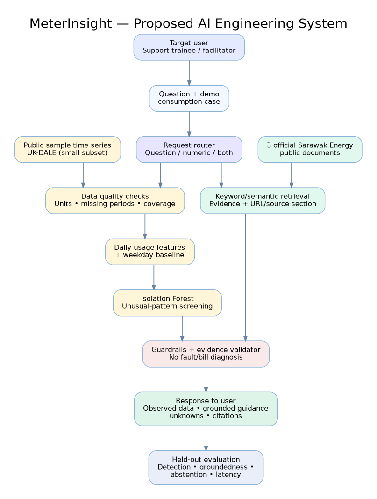

# MeterInsight — Conceptual AI System Map

This is a **planned** architecture; no functional model has been trained or evaluated yet.

- **Data branch:** public sample consumption time series → units/coverage checks → daily features and simple baseline → Isolation Forest unusual-pattern screening.
- **Document branch:** three official Sarawak Energy public documents → citation-bearing keyword/semantic retrieval.
- **Response branch:** combine observed numerical facts and retrieved official explanations, verify that conclusions are properly bounded, and separate *knowns* from *unknowns*.
- **User-facing output:** flagged patterns, sourced general information, and appropriate advice to seek authorised review for actual billing disputes.
- **Evaluation:** controlled-event detection, numerical correctness, retrieval groundedness, unsupported-claim prevention, abstention, and latency.

Editable source: `week1_system_map.dot` (Graphviz). Public documents are referenced by URL; restricted document content is not packaged.
